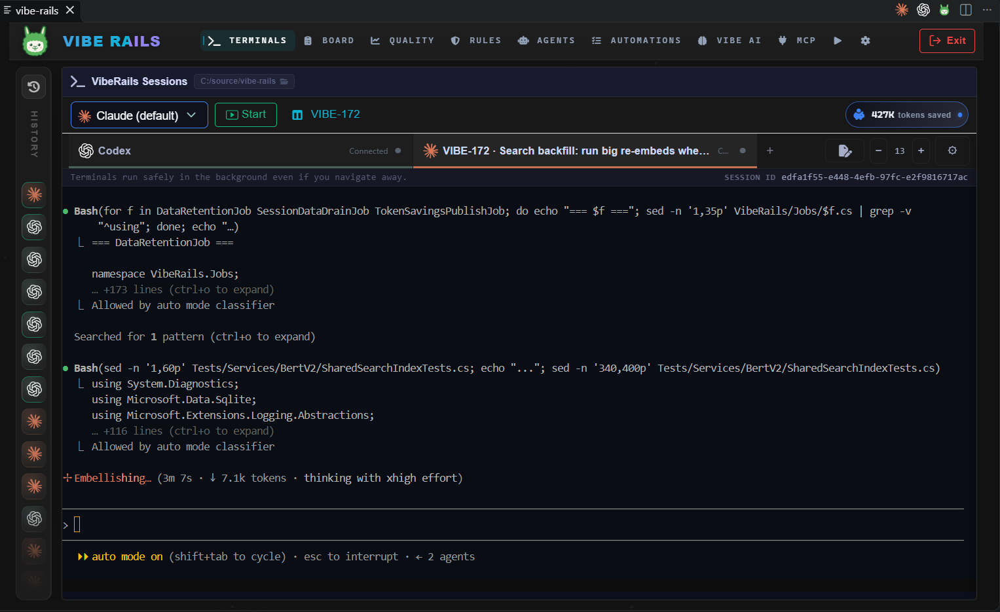
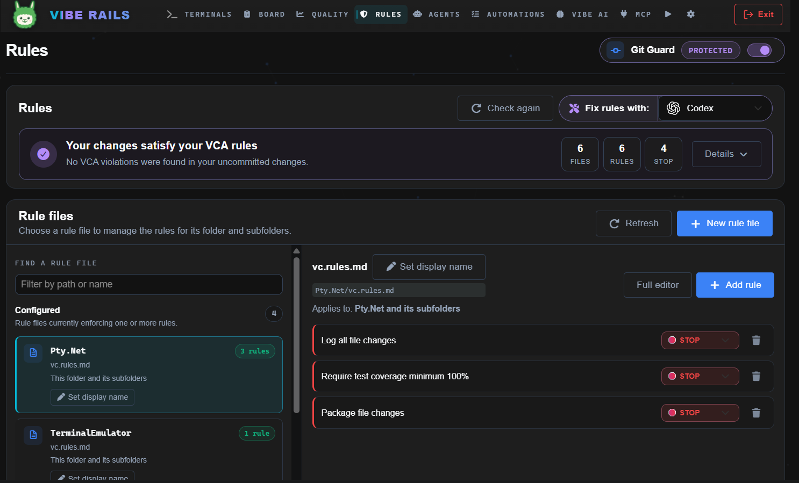
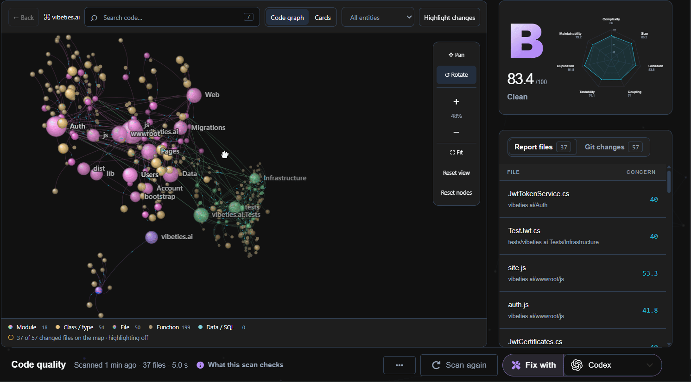
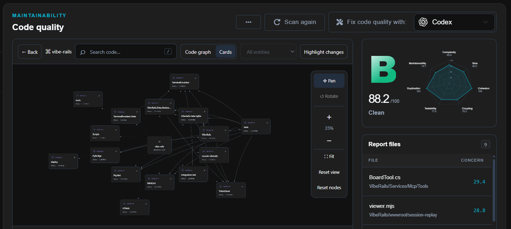
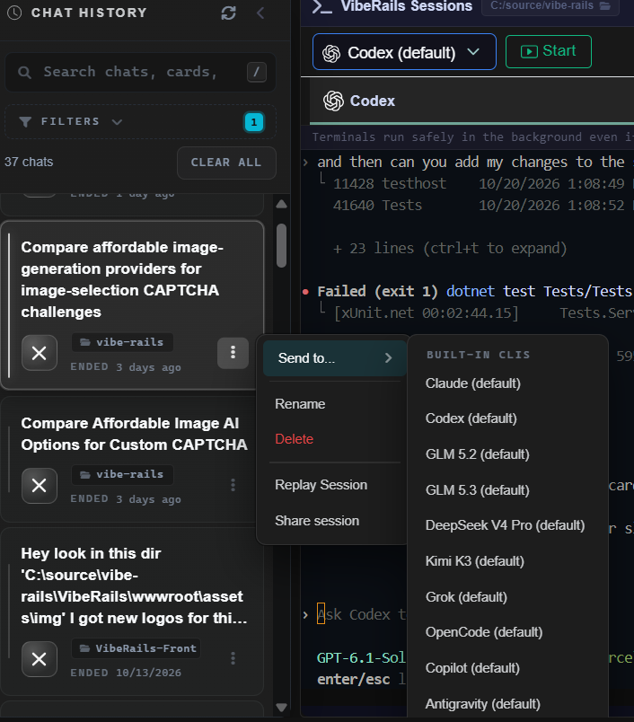
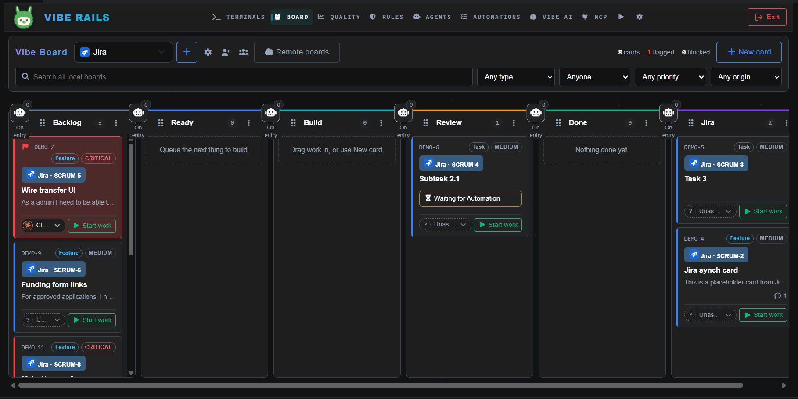

<div align="center">
  
  <h1>VibeRails</h1>
  <p><strong>A framework for AI-assisted development with repository rules, review workflows, and session traceability.</strong></p>
  <p>
    <a href="https://marketplace.visualstudio.com/items?itemName=viberails.vscode-viberails"></a>
    <a href="https://dotnet.microsoft.com/"></a>
    <a href="https://www.typescriptlang.org/"></a>
    <a href="LICENSE"></a>
    <a href="https://viberails.ai/"></a>
  </p>
</div>

VibeRails gives developers and engineering teams a common workflow around the AI coding tools
they already use. Run Claude Code, Codex, and other supported CLIs from VS Code or a browser.
Apply repository standards, inspect code quality, and bring the recorded work into review.

For enterprise teams, that means a shared process for rules, human approval, issue tracking,
and corporate API gateways. For developers, it means real terminals, reusable agent setups,
searchable history, and fewer manual handoffs. The core application runs on your machine.



## Built for developers and engineering teams

| Need | What VibeRails provides |
| --- | --- |
| Consistent repository standards | Versioned `vc.rules.md` rules, Git Guard hooks, and code quality checks. |
| Reviewable AI work | Recorded sessions, replay, linked commits, and human review requests for staged changes. |
| Existing team workflows | Project Boards with Jira Cloud and Azure DevOps work item integrations. |
| Repeatable agent work | Saved Quick Launches, Agents, and script/check Automations. |
| Corporate provider access | Configurable API gateways for supported providers, including Codex and Claude. |
| Continuity across tools | Shared session search, session handoffs, and a built-in MCP server. |

[Repository standards](#repository-standards-and-code-quality) · [Review and traceability](#review-and-session-traceability) ·
[Boards and issue trackers](#boards-and-issue-trackers) · [Agents and Automations](#agents-and-automations) ·
[Enterprise integration](#enterprise-integration-and-data-flow) · [Install](#install) · [Build](#build-from-source)

## Repository standards and code quality

Keep rules alongside the code in `vc.rules.md`, under a `## Vibe Rails Rules` heading.
With Git Guard enabled, the installed Git hooks evaluate applicable rules for staged changes:

- **WARN** reports a finding.
- **COMMIT** requires an acknowledgment and reason in the commit message.
- **STOP** blocks the commit when the rule fails.

The dashboard and the `validate_vca` MCP tool make the same rule system available to developers
and agents. Rules can cover change documentation, code quality thresholds, protected paths,
and signed approval requirements.



The MintLint code quality report scores supported source code, identifies files that need
attention, and shows relationships as a code graph or connected module cards. Highlight changes
to focus a review, or use **Fix code quality with…** to hand the report to an agent.





## Review and session traceability

VibeRails records sessions launched through it so a reviewer can inspect the prompts, terminal
activity, and decisions behind a change. Replay recorded work, follow a Board card's linked
commits and sessions, or search past work by meaning and keyword in **Vibe AI**. Agents can search
the same history through MCP.

**Review requests** bring a person into the workflow before a commit. Capture staged changes and
attach the sessions that produced them, then send the request to named reviewers through
viberails.ai. Reviewers can inspect the changes and session context, leave comments, and approve
or reject. Signed approvals apply to the exact staged tree; a repository's configured approval
rules determine when they are required. The VS Code sidebar includes **Reviews requested of you**.

The **Reviews** page also tracks GitHub pull request reviews across configured repositories.
**Send to…** summarizes a recorded session for another supported CLI or saved setup, giving a
second agent context for the next task or review.



## Boards and issue trackers

Use a project Board to plan work, assign an agent, and retain comments, handoffs, linked commits,
and sessions with the card. Starting work gives the agent the card's brief. Lane entry can run
configured Agents and Automations, such as a review or a code quality check.

Connect a Board to **Jira Cloud** or **Azure DevOps** to pull work into VibeRails and send comments
and session references back to the linked issue or work item. Teams can keep their existing
tracker while reviewing the agent's work with its context.



## Agents and Automations

Work in real PTY-backed terminals with Claude Code, Codex, other supported CLIs, or a shell.
Sessions continue while you move between dashboard pages.

- **Quick Launches** save a CLI, model, arguments, and settings for reuse.
- **Agents** add a starting message to a saved setup and run on demand or on configured triggers.
- **Automations** run ordered scripts and checks without an LLM step. They can run on demand,
  on a schedule, around commits, or when a card enters a Board lane.

Agent work can use the project folder, a separate clone, or a fresh clone for each run.
The signed scripts library supports reusable PowerShell, Bash, and Python workflows.
The VS Code **Launch** sidebar makes Agents, Automations, and scripts available beside your code.

Agents and Automations run while a VibeRails root backend is open. In VS Code, closing only the
dashboard tab leaves that backend running; **VibeRails: Stop**, the dashboard's **Exit** button,
or closing the VS Code window stops it. There is no operating-system background service.

> Agents and scripts run with your operating-system account's permissions, including when they
> use a separate clone. Review the prompts, tools, and scripts before enabling unattended work.

## Enterprise integration and data flow

Configure corporate API gateway URLs in **Settings → LLMs** for supported providers. Codex and
Claude support saved gateway credentials; requests pass through the local relay to a gateway
that accepts the provider's API format. This allows teams to use their existing provider access
and network controls. See the [gateway configuration guide](TokenSaver/README.md#enterprise-network-proxy).

The application stores configuration and session history under `~/.vibe_rails/`, with repository
rules kept in the project. The VS Code backend listens on loopback and authenticates dashboard
and API access. AI requests go to the configured provider or gateway.

Connecting a **viberails.ai** account enables hosted collaboration and uploads completed sessions
to that account. Sending review requests, sharing sessions, and connecting issue trackers also
transfer the corresponding content to those services. Account connection and sharing should
follow your team's data-handling policy. See the [API security contract](API_SEC.md) for the
implemented authentication and data boundaries.

## TokenSaver and MCP

**TokenSaver** can reduce the tool output sent to Claude Code and Codex by trimming repeated
lines, build noise, and passing test output. It preserves user prompts and model replies;
marked trims let the agent request narrower output when needed. Savings depend on the workload
and appear in the terminal's **tokens saved** meter.

The built-in **MCP server** connects supported agents to Board work, handoffs, review tracking,
history search, rule validation, and TokenSaver controls. Use **MCP Explorer** to inspect tool
descriptions and input schemas or call tools directly. This makes VibeRails workflows available
to agents as well as to people using the dashboard.

## Install

**VS Code:** install [VibeRails from the Marketplace](https://marketplace.visualstudio.com/items?itemName=viberails.vscode-viberails).
The extension bundles the VibeRails backend and dashboard. Open it from the **VibeRails** status-bar
button, `VibeRails: Open Dashboard`, or `Ctrl+Alt+V` (`Cmd+Alt+V` on macOS).

**Standalone:** installers for Windows, Linux, and macOS are available at [viberails.ai](https://viberails.ai/).

**Windows setup:** download `VibeRails-Setup-<version>-win-x64.exe` from the
[GitHub release assets](https://github.com/robstokes857/vibe-rails/releases/latest) when available.
It installs for your user without administrator privileges, adds a Start menu shortcut, and
offers a desktop shortcut. Upgrades and uninstall preserve your VibeRails data. The ZIP and
PowerShell installer remain available.

Install and authenticate the AI CLI you want to use, such as Claude Code or Codex.
To connect a viberails.ai account, open **Settings → General → Account** and choose **Sign in**.

## Build from source

Prerequisites: the [.NET 10 SDK](https://dotnet.microsoft.com/download),
[Node.js 24 LTS](https://nodejs.org/) or later (builds read `.nvmrc`), Git, and VS Code 1.125 or
later for the extension.

```bash
git clone --recurse-submodules https://github.com/robstokes857/vibe-rails.git
cd vibe-rails/VibeRails
dotnet run
```

The dashboard opens in your default browser. In an existing clone, run
`git submodule update --init --recursive` once to fetch the submodules.

To work on the VS Code extension, follow the [extension guide](vscode-viberails/AGENTS.md#development).
Test commands for every layer are in [AGENTS.md](AGENTS.md#build-and-test).

## Documentation

| Topic | Where |
| --- | --- |
| Contributor policy and where to start by area | [AGENTS.md](AGENTS.md) |
| Architecture reference | [docs/architecture.md](docs/architecture.md) |
| API security contract | [API_SEC.md](API_SEC.md) |
| Git Guard hook installation | [docs/git-hooks.md](docs/git-hooks.md) |
| Human review requests | [Review requests contract](VibeRails/Services/ReviewRequests/README.md) |
| TokenSaver and corporate gateways | [TokenSaver/README.md](TokenSaver/README.md) |
| Internal tools and feature logs | [docs/internal-tools.md](docs/internal-tools.md) |
| VS Code extension | [vscode-viberails/README.md](vscode-viberails/README.md) |

## Project

VibeRails is an open-source application for developers and teams adopting AI-assisted development.
The project focuses on repository rules, visible agent work, repeatable workflows, and review.
Features and their operating boundaries are documented in this repository.

## License

[MIT](LICENSE)

---

**Maintained by** Robert Stokes · **Last updated** 2026-10-30
